<div align="center">

  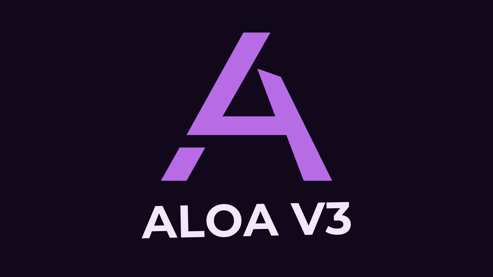

  # THE ALOA V3 — Autonomous Laptop Operating Agent
  ### *Your Laptop. Run by an Agent.*

  <p align="center">
    <strong>A production-grade, hybrid autonomous operating system agent that perceives intent, reasons across a multi-model resilient AI backbone, and executes directly on your operating system and the cloud.</strong>
  </p>

  <p align="center">
    <a href="https://aloav3.com"></a>
    <a href="https://github.com/thepeeyushyadav/THE-ALOA"></a>
    <a href="https://nextjs.org"></a>
    <a href="https://fastapi.tiangolo.com"></a>
    <a href="https://www.python.org"></a>
    <a href="https://opensource.org/licenses/MIT"></a>
  </p>

</div>

---

## 📌 Table of Contents

- [1. Executive Summary & Vision](#1-executive-summary--vision)
- [2. Visual Showcase & Interface](#2-visual-showcase--interface)
- [3. Hybrid Architecture & How It Works](#3-hybrid-architecture--how-it-works)
  - [3.1 Web Frontend Architecture (Next.js 14)](#31-web-frontend-architecture-nextjs-14)
  - [3.2 Cloud Backend Architecture (FastAPI & SSE)](#32-cloud-backend-architecture-fastapi--sse)
  - [3.3 Windows Companion Agent Architecture](#33-windows-companion-agent-architecture)
  - [3.4 Security & Zero-Trust Governance](#34-security--zero-trust-governance)
- [4. The 10 Core Automations (Deep Dive)](#4-the-10-core-automations-deep-dive)
  - [Feature 01: App Manager](#feature-01-app-manager)
  - [Feature 02: System Doctor](#feature-02-system-doctor)
  - [Feature 03: Attendance Automator](#feature-03-attendance-automator)
  - [Feature 04: YouTube Smart Notes](#feature-04-youtube-smart-notes)
  - [Feature 05: Exam Pilot](#feature-05-exam-pilot)
  - [Feature 06: Code Healer](#feature-06-code-healer)
  - [Feature 07: Cloud Healer](#feature-07-cloud-healer)
  - [Feature 08: Auto-Deployer](#feature-08-auto-deployer)
  - [Feature 09: Resume Engine](#feature-09-resume-engine)
  - [Feature 10: ALOA Radar](#feature-10-aloa-radar)
- [5. Installation & Setup Guide](#5-installation--setup-guide)
- [6. Deployment Architecture (Vercel & Render)](#6-deployment-architecture-vercel--render)
- [7. Development Team & Attribution](#7-development-team--attribution)
- [8. Contact & Community](#8-contact--community)

---

## 1. Executive Summary & Vision

**THE ALOA V3** (**A**utonomous **L**aptop **O**perating **A**gent) is a next-generation agentic desktop operating platform. Unlike conventional chatbots that simply generate conversational text, ALOA is built around an autonomous closed-loop paradigm:

$$\text{Perceive Intent} \longrightarrow \text{Multi-Model Reasoning} \longrightarrow \text{OS/Cloud Execution} \longrightarrow \text{Feedback \& Self-Correction}$$

ALOA unifies 10 specialized automation engines into a single synchronized ecosystem. Whether it is self-healing broken source code, triaging Windows system vitals, auto-marking institutional attendance in Excel, or generating ATS-grade resumes, ALOA bridges the gap between natural language intention and deterministic operating system actions.

### 📊 Repository Key Metrics

| Metric | Specification |
| :--- | :--- |
| **System Architecture** | Hybrid (Vercel Cloud Edge + Render Backend + Local Windows Companion Agent) |
| **Frontend Framework** | Next.js 14 (App Router), React 18, TypeScript, Tailwind CSS |
| **Backend Framework** | FastAPI (Python 3.10+), Uvicorn ASGI, Server-Sent Events (SSE), WebSockets |
| **AI Orchestration Backbone** | Groq (Llama 3.3 70B), Google Gemini (2.5 Flash / 2.0 Flash), AWS Bedrock, OpenRouter |
| **Supported OS** | Windows 10 / Windows 11 (Desktop Agent) & All Modern Browsers (Web GUI) |
| **Active Core Modules** | **10 Dedicated Production Automations** |
| **Codebase Size** | **8,000+ Lines of Rigorous Python & TypeScript** |

---

## 2. Visual Showcase & Interface

ALOA V3 features a dark, responsive user interface designed for developers and power users.

<div align="center">
  <table>
    <tr>
      <td width="33%" align="center">
        
        <br />
        <strong>Autonomous Code Healer</strong>
        <br />
        <em>Local & cloud real-time diagnostic engine</em>
      </td>
      <td width="33%" align="center">
        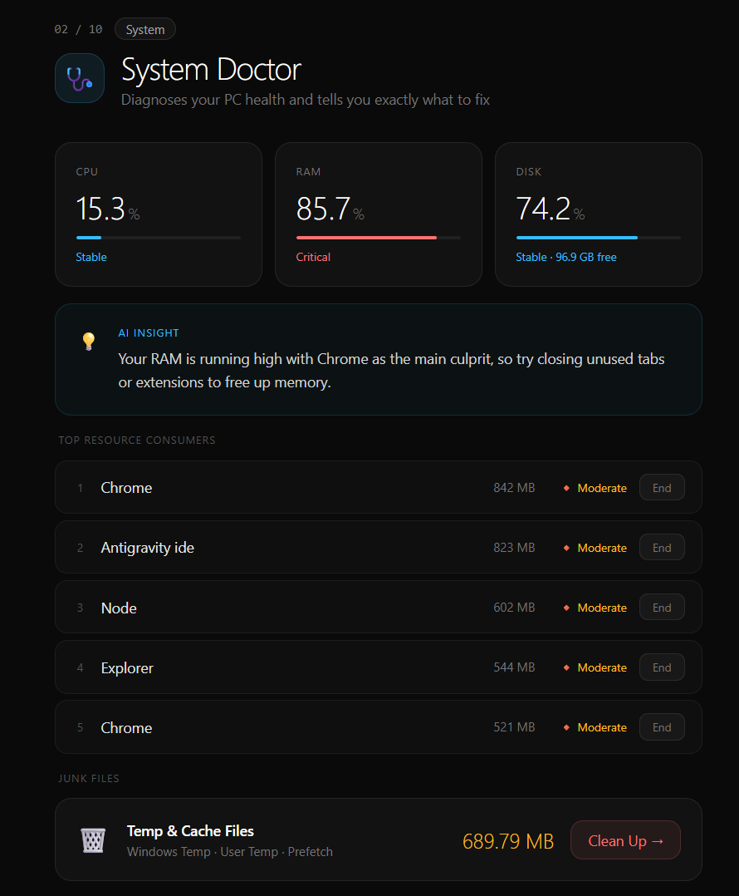
        <br />
        <strong>Multi-Cloud Pipeline</strong>
        <br />
        <em>Vercel, Render & GitHub continuous shipping</em>
      </td>
      <td width="33%" align="center">
        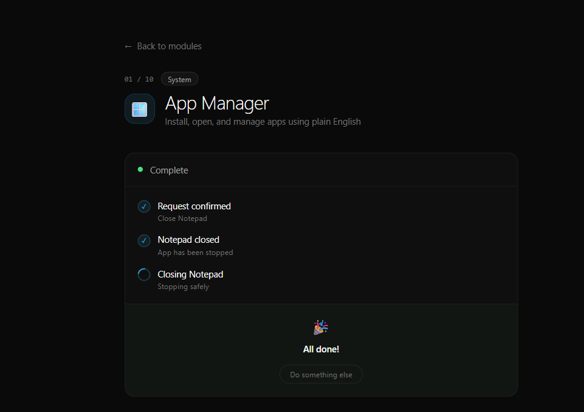
        <br />
        <strong>Intelligence & Productivity Hub</strong>
        <br />
        <em>YouTube Notes, Resume ATS & Trend Radar</em>
      </td>
    </tr>
  </table>
</div>

---

## 3. Hybrid Architecture & How It Works

ALOA V3 operates on a **Zero-Trust Hybrid Architecture**. Traditional web apps cannot access a user's local operating system due to browser sandbox restrictions. ALOA solves this by combining a modern cloud interface with an encrypted, outbound WebSocket tunnel to a lightweight Windows Companion Agent.

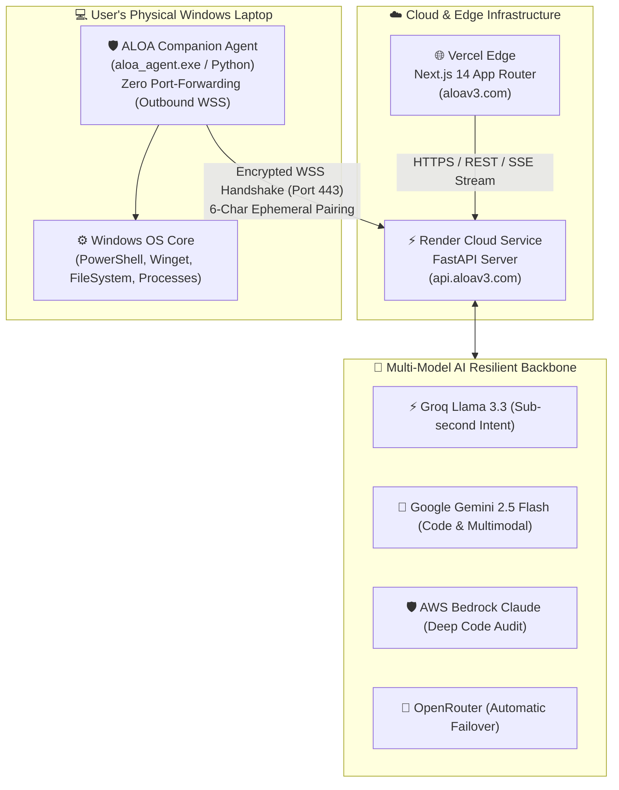

### 3.1 Web Frontend Architecture (Next.js 14)
- **App Router & Server-Side Rendering (SSR):** Fast initial page delivery with client-side state hydration.
- **Pure CSS Performance:** Completely free of heavy runtime animation dependencies (zero SSR hydration mismatch; 43 kB lighter client bundle).
- **Dual Dynamic Theme Detection:** Seamless automatic navigation contrast (light charcoal palette on landing hero; deep navy `#070b14` on technical modules).
- **Reactive Streaming:** Consumes native `text/event-stream` (Server-Sent Events) for real-time log terminal output, progress bars, and live diff trees.

### 3.2 Cloud Backend Architecture (FastAPI & SSE)
- **Asynchronous Execution:** Non-blocking endpoints powered by `asyncio` and `uvicorn`, routing compute-intensive jobs to background thread pools.
- **Resilient AI Key Rotation:** Automatic fallback across API keys and providers (Groq $\rightarrow$ Gemini $\rightarrow$ OpenRouter $\rightarrow$ Bedrock) when rate limits ($429$) or quotas are triggered.
- **Decoupled Architecture:** Core logic cleanly separated into `features/feature_X/core.py`, making every module independently testable.

### 3.3 Windows Companion Agent Architecture
- **No Port Forwarding Required:** Establishes an *outbound* secure WebSocket connection (`wss://api.aloav3.com/ws/agent`) directly to the backend over standard HTTPS port 443.
- **Ephemeral 6-Character Pairing:** Generates a secure, 5-minute time-to-live (TTL) pairing code (e.g., `K8X2M9`) rendered in a clean desktop widget.
- **Local Fallback Mode:** When running directly on the local machine (`http://localhost:3000`), ALOA automatically auto-detects the host system (`platform.node()`) without requiring any manual pairing steps.

### 3.4 Security & Zero-Trust Governance
- 🔒 **Air-Gapped Credentials:** Sensitive tokens (GitHub PATs, Vercel/Render keys) are held strictly on the client or masked in local configs; they are never permanently stored on backend databases.
- 🛡️ **Interactive Human-in-the-Loop Confirmation:** High-impact system actions (killing system processes, installing software, overwriting source files) require explicit user confirmation before execution.
- 🧹 **Sandboxed Execution:** Cloud operations (like Cloud Healer) clone remote repositories into ephemeral, isolated temporary folders (`tempfile.gettempdir()`) with guaranteed teardown on session exit.

---

## 4. The 10 Core Automations (Deep Dive)

ALOA V3 features 10 specialized autonomous modules designed for everyday utility, developer productivity, and system optimization.

```
┌─────────────────────────────────────────────────────────────────────────────────┐
│                           THE 10 ALOA V3 AUTOMATIONS                            │
├─────────────────────┬───────────────────────────┬───────────────────────────────┤
│ 01. App Manager     │ 04. YouTube Smart Notes   │ 07. Cloud Healer              │
│ 02. System Doctor   │ 05. Exam Pilot            │ 08. Auto-Deployer (In Pipeline│
│ 03. Attendance Auto │ 06. Code Healer           │ 09. Resume Engine             │
│                     │                           │ 10. ALOA Radar                │
└─────────────────────┴───────────────────────────┴───────────────────────────────┘
```

---

### Feature 01: App Manager
> **"Open Spotify" / "Install VLC" / "Remove Chrome"**

App Manager translates natural language (English or Hinglish) into concrete Windows operating system package management actions.

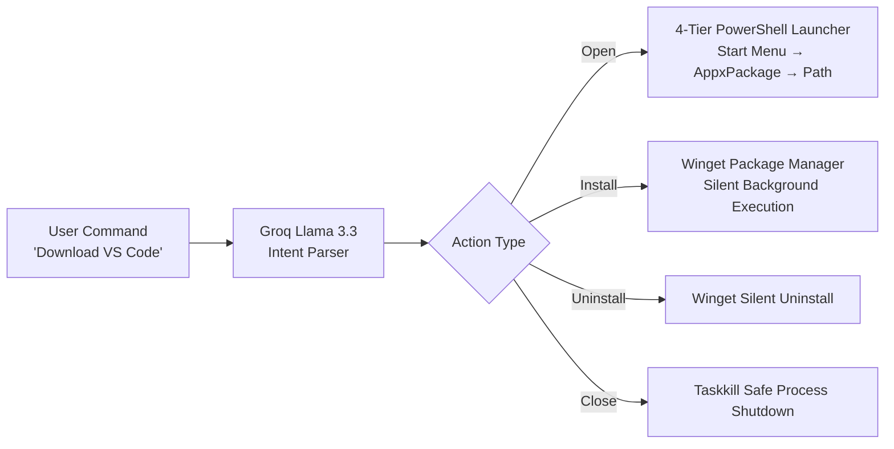

- **4-Tier Smart Launcher:** 
  1. Searches Windows Start Menu `.lnk` shortcuts.
  2. Searches modern Windows Store apps via `Get-AppxPackage`.
  3. Direct binary execution via `Start-Process`.
  4. Scans canonical installation folders (`C:\Program Files`, `AppData`).
- **Hands-Free Installation:** Executes `winget install <App> -e --silent --accept-package-agreements` and auto-opens the software as soon as installation finishes.

---

### Feature 02: System Doctor
> **Real-time Vitals, Military-Grade Process Killer & Automated Junk Cleaner**

An intelligent Windows diagnostic health monitor that pinpoints runaway processes and frees gigabytes of cluttered disk space.

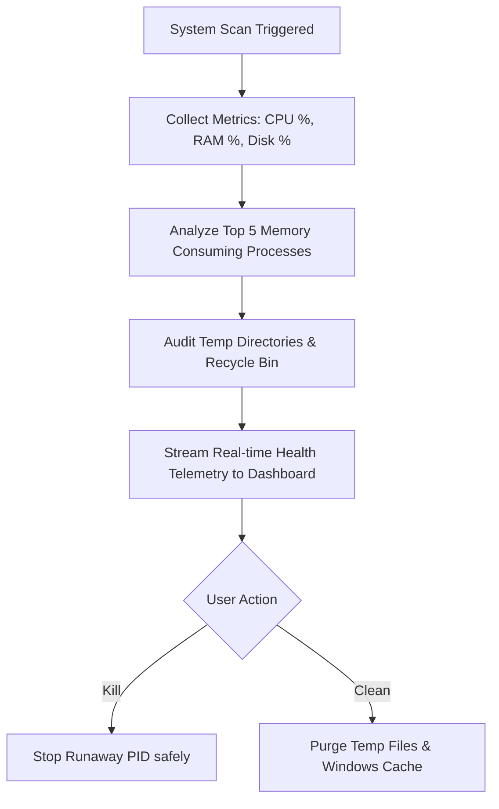

- **Telemetry Tracking:** Monitors CPU usage across all logical cores, virtual RAM allocations, and disk drive capacities.
- **Intelligent Impact Classification:** Flags processes dynamically as `Normal`, `Moderate`, or `Critical` based on active memory footprints.
- **Safe Junk Purge:** Safely sweeps `%TEMP%`, `C:\Windows\Temp`, and browser cache trees with detailed space-freed audit logging.

---

### Feature 03: Attendance Automator
> **Mark Entire Class Attendance in 30 Seconds**

A specialized institutional tool for educators, professors, and managers that automates Excel spreadsheet attendance registers.

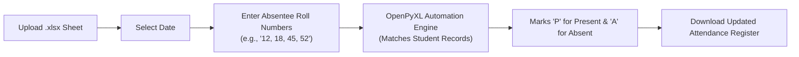

- **Smart Column Detection:** Parses date headers across diverse Excel formats without breaking formulas or existing styling.
- **Inverse Absentee Logic:** Automatically marks the entire roster as `Present` (P) while rapidly applying `Absent` (A) exclusively to listed absentee roll numbers.
- **Formula Integrity Preservation:** Preserves existing macros, formatting, and total calculation columns.

---

### Feature 04: YouTube Smart Notes
> **Instant Lecture Video $\longrightarrow$ Structured Study Guide + Formatted PDF**

Converts multi-hour educational YouTube videos into comprehensive, professor-grade markdown study notes and shareable PDFs.

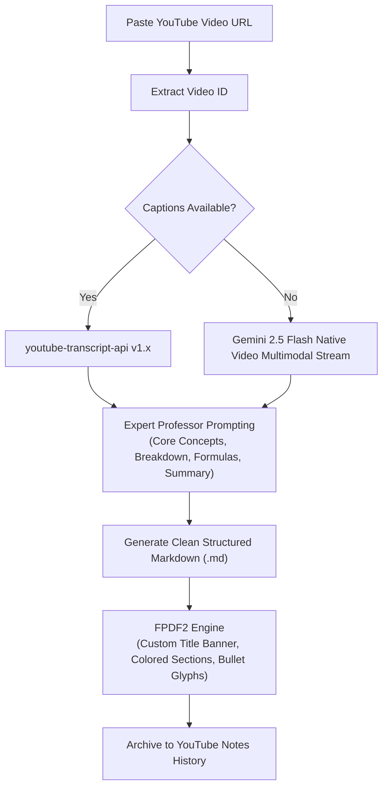

- **Dual-Stream Transcript Engine:** Fetches standard captions; if disabled, falls back to direct Gemini 2.5 Flash multimodal video understanding.
- **Key Rotation Protection:** Rotates multiple Google Gemini API keys to bypass quota limitations on long video transcripts.
- **Publication-Ready PDF Generation:** Built-in PDF generation with custom title banners, Latin-1 safe emoji translation, and section-themed color accents.

---

### Feature 05: Exam Pilot
> **On-Screen Optical Character Recognition & Autonomous Quiz Solver**

An on-screen computer vision automation tool that reads multiple-choice questions from active quiz windows and marks correct answers.

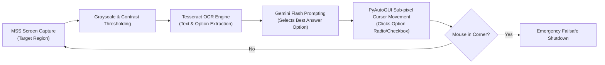

- **High-Precision Image Preprocessing:** Cleans and sharpens quiz UI captures to maximize OCR text recognition accuracy.
- **Fail-Safe Mechanism:** Built with PyAutoGUI corner-throw fail-safes so users retain full emergency control.

---

### Feature 06: Code Healer
> **Point, Run, Diagnose, Fix, Diff & Auto-Apply**

An autonomous local software debugging agent that navigates project folders, detects errors, and writes deterministic code patches.

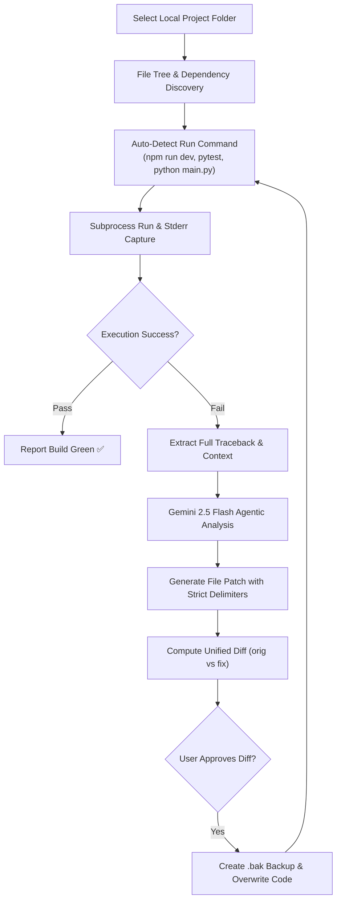

- **Native Windows Folder Browser:** Uses PowerShell WinForms GUI to guarantee the folder picker always pops up in the foreground.
- **Unified Diff Generation:** Generates syntax-highlighted hunk diffs so you can inspect additions and deletions before changing code.
- **Automatic Rollback Backups:** Creates `.bak` safety copies before modifying any project files on disk.

---

### Feature 07: Cloud Healer
> **Zero-Clone Autonomous Debugging for Remote GitHub Repositories**

Debug and patch codebases directly on GitHub without manually cloning repositories or configuring local development environments.

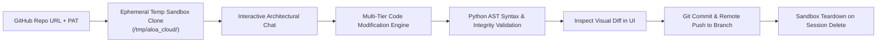

- **Multi-Tier Patching Precision:** Employs exact string matching, line-trimmed matching, and structural AST blocks to prevent invalid code writes.
- **Direct Remote Push:** Pushes fixes directly to designated GitHub branches so your cloud CI/CD pipelines trigger automatically.

---

### Feature 08: Auto-Deployer *(Pipeline Architecture)*
> **One-Command Stack Detection, Git Push & Cloud Deployment**

Automatically detects project architecture (Next.js, FastAPI, Django, Vite, Flask) and orchestrates multi-cloud deployments to Vercel and Render.

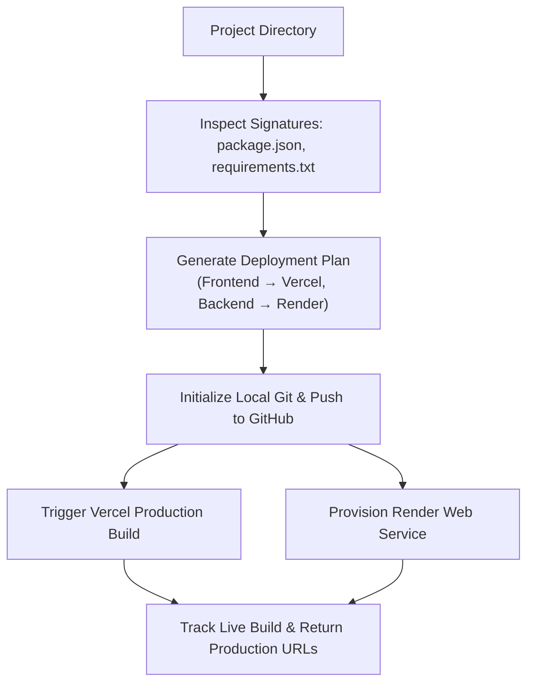

---

### Feature 09: Resume Engine
> **Brain Dump $\longrightarrow$ ATS Scoring $\longrightarrow$ STAR Bullet Polishing $\longrightarrow$ 3 HTML/PDF Templates**

An intelligent career utility that transforms unstructured work history notes into high-scoring, ATS-optimized resumes.

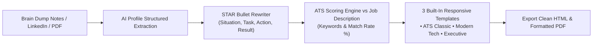

- **STAR Method Optimization:** Automatically converts passive bullet points into impactful, metric-driven achievement statements.
- **Job Description Gap Analysis:** Compares your resume against job descriptions, identifying missing keywords and ATS vulnerabilities.
- **3 Responsive Templates:** Choose between `ATS Classic`, `Modern Tech`, and `Executive Minimalist` layouts.

---

### Feature 10: ALOA Radar
> **Personalized Daily Tech Intelligence Briefing**

Aggregates breaking tech updates, framework releases, and discussions across 6+ live internet developer hubs.

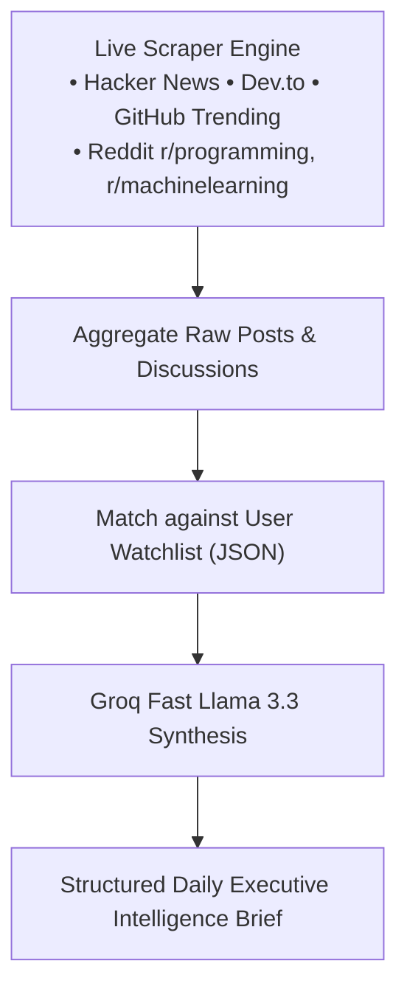

- **Zero-Hallucination Scraping:** Pulls real-time feeds from Hacker News, Dev.to, GitHub Trending, and Reddit.
- **Personalized Watchlist:** Filter topics and companies based on your custom `radar_watchlist.json`.
- **Sub-Second Synthesis:** Synthesizes hundreds of posts into a bulleted daily briefing via Groq Llama 3.3.

---

## 5. Installation & Setup Guide

### 📋 Prerequisites
- **Operating System:** Windows 10 or Windows 11 (for Companion Agent & OS automations).
- **Python:** Version `3.10.x` or `3.11.x` installed with `PATH` configured.
- **Node.js:** Version `18.x` or `20.x` LTS.
- **Git:** Installed on local machine.

---

### 💻 Local Development Setup

#### 1. Clone the Repository
```bash
git clone https://github.com/thepeeyushyadav/THE-ALOA.git
cd THE-ALOA
```

#### 2. Backend Environment Setup
```bash
# Create and activate Python virtual environment
python -m venv .venv
.venv\Scripts\activate

# Install backend dependencies
pip install -r requirements.txt
```

#### 3. Frontend Environment Setup
```bash
cd frontend
npm install
cd ..
```

#### 4. Configure Environment Variables
Create a `.env` file in the project root:
```env
# Multi-Model AI API Keys
GROQ_API_KEY="your-groq-api-key"
GEMINI_API_KEY_1="your-primary-gemini-key"
GEMINI_API_KEY_2="your-backup-gemini-key"
OPENROUTER_API_KEY="your-openrouter-key"
BEDROCK_API_KEY="your-aws-bedrock-key"

# Optional Cloud Deployment Keys
GITHUB_PAT="ghp_yourpersonalaccesstoken"
VERCEL_TOKEN="your-vercel-token"
RENDER_API_KEY="rnd_yourrenderkey"
```

#### 5. Launch Full-Stack ALOA
Open two terminal windows:

**Terminal 1 (Backend API Server):**
```bash
# Runs FastAPI on http://localhost:8000
python -m uvicorn backend.server:app --port 8000 --reload
```

**Terminal 2 (Next.js Web Interface):**
```bash
cd frontend
# Runs Next.js on http://localhost:3000
npm run dev
```

Visit **`http://localhost:3000`** in your browser.

---

## 6. Deployment Architecture (Vercel & Render)

ALOA V3 is architected for continuous zero-downtime deployment:

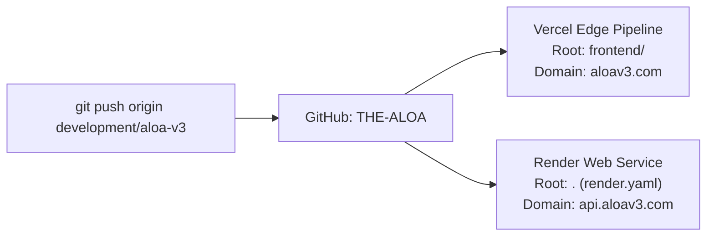

- **Frontend (Vercel):** Pre-configured for Next.js App Router. Set root directory to `frontend/` and add `NEXT_PUBLIC_API_URL=https://api.aloav3.com`.
- **Backend (Render):** Managed via `render.yaml` with automatic dependency installation from `requirements-cloud.txt` and live health checks at `/api/health`.
- **DNS Routing:** Apex domain `aloav3.com` routed via Vercel Anycast DNS; subdomain `api.aloav3.com` mapped via CNAME to Render.

---

## 7. Development Team & Attribution

**THE ALOA V3** is developed with equal ownership and shared responsibility by three core software engineers from **Medi-Caps University, Indore (M.P.), India**.

<div align="center">
  <table>
    <tr>
      <!-- Piyush Solanki -->
      <td width="33%" align="center" valign="top">
        
        <br />
        <h3 style="margin-bottom: 2px;">Piyush Solanki</h3>
        <p><strong>Full-Stack & AI Integration Developer</strong></p>
        <p><em>Contribution: 33.33%</em></p>
        <hr style="border: 0; border-top: 1px solid #e5e7eb; margin: 8px 0;" />
        <p align="left" style="font-size: 12px; line-height: 1.5;">
          🎓 <strong>Enrollment:</strong> <code>EN23CS304045</code><br />
          🆔 <strong>Scholar No:</strong> <code>2300395</code><br />
          📚 <strong>Program:</strong> B.Tech – CSE (AI)<br />
          🏛️ <strong>University:</strong> Medi-Caps University<br />
          📅 <strong>Batch:</strong> 2023 – 2027
        </p>
        <hr style="border: 0; border-top: 1px solid #e5e7eb; margin: 8px 0;" />
        <p align="left" style="font-size: 12px;">
          <strong>Assigned Core Modules:</strong><br />
          • Feature 03: Attendance Automator<br />
          • Feature 04: YouTube Smart Notes<br />
          • Feature 09: Resume Engine<br />
          • Feature 10: ALOA Radar
        </p>
        <div>
          <a href="https://github.com/piyushsolanki8934"></a>
          <a href="https://www.linkedin.com/in/piyush-solanki-38850b2a5/"></a>
          <br />
          <a href="mailto:solankipiyush1946@gmail.com"></a>
        </div>
      </td>
      <!-- Mayank Sahu -->
      <td width="33%" align="center" valign="top">
        
        <br />
        <h3 style="margin-bottom: 2px;">Mayank Sahu</h3>
        <p><strong>System Automation & Backend Developer</strong></p>
        <p><em>Contribution: 33.33%</em></p>
        <hr style="border: 0; border-top: 1px solid #e5e7eb; margin: 8px 0;" />
        <p align="left" style="font-size: 12px; line-height: 1.5;">
          🎓 <strong>Enrollment:</strong> <code>EN23CS304037</code><br />
          🆔 <strong>Scholar No:</strong> <code>2302374</code><br />
          📚 <strong>Program:</strong> B.Tech – CSE (AI)<br />
          🏛️ <strong>University:</strong> Medi-Caps University<br />
          📅 <strong>Batch:</strong> 2023 – 2027
        </p>
        <hr style="border: 0; border-top: 1px solid #e5e7eb; margin: 8px 0;" />
        <p align="left" style="font-size: 12px;">
          <strong>Assigned Core Modules:</strong><br />
          • Feature 01: App Manager<br />
          • Feature 02: System Doctor<br />
          • Feature 05: Exam Pilot
        </p>
        <div>
          <a href="https://github.com/mayankksahuu"></a>
          <a href="https://www.linkedin.com/in/mayank-sahu-29644a2b0/"></a>
          <br />
          <a href="mailto:mayanksahu55074@gmail.com"></a>
        </div>
      </td>
      <!-- Piyush Pal -->
      <td width="33%" align="center" valign="top">
        
        <br />
        <h3 style="margin-bottom: 2px;">Piyush Pal</h3>
        <p><strong>AI & Backend Developer</strong></p>
        <p><em>Contribution: 33.33%</em></p>
        <hr style="border: 0; border-top: 1px solid #e5e7eb; margin: 8px 0;" />
        <p align="left" style="font-size: 12px; line-height: 1.5;">
          🎓 <strong>Enrollment:</strong> <code>EN23CS304044</code><br />
          🆔 <strong>Scholar No:</strong> <code>2302214</code><br />
          📚 <strong>Program:</strong> B.Tech – CSE (AI)<br />
          🏛️ <strong>University:</strong> Medi-Caps University<br />
          📅 <strong>Batch:</strong> 2023 – 2027
        </p>
        <hr style="border: 0; border-top: 1px solid #e5e7eb; margin: 8px 0;" />
        <p align="left" style="font-size: 12px;">
          <strong>Assigned Core Modules:</strong><br />
          • Feature 06: Code Healer<br />
          • Feature 07: Cloud Healer<br />
          • Feature 08: Auto-Deployer
        </p>
        <div>
          <a href="https://www.piyushpal.com/"></a>
          <a href="https://github.com/thepeeyushyadav"></a>
          <br />
          <a href="https://www.linkedin.com/in/piyush-pal-751067306/"></a>
        </div>
      </td>
    </tr>
  </table>
</div>

---

### 🤝 Shared Engineering Responsibilities

ALOA V3 is a tightly integrated major software engineering project. Beyond individual module assignments, all three engineers collaborated across the entire development lifecycle:

| Engineering Dimension | Key Contributions Across All Developers | Ownership |
| :--- | :--- | :---: |
| **System Architecture Design** | Hybrid edge-to-desktop paradigm, WebSocket protocol, and device pairing handshakes | **All 3 Developers** |
| **Code Review & Standards** | Peer code reviews, strict typing validation, and clean-code refactoring | **All 3 Developers** |
| **End-to-End Testing** | Cross-browser compatibility, Windows OS regression tests, and stress testing | **All 3 Developers** |
| **Security & Privacy Audits** | Safe process execution, sandboxed workspaces, and token protection | **All 3 Developers** |
| **Documentation & Production** | System architecture diagrams, user guides, and cloud deployment pipelines | **All 3 Developers** |

---

## 8. Contact & Community

Have questions, suggestions, or want to collaborate on ALOA V3?

- 📧 **Official Project Inquiries:** [hello.aloav3@gmail.com](mailto:hello.aloav3@gmail.com)
- 🌐 **Official Website:** [https://aloav3.com](https://aloav3.com)
- 🐛 **Bug Reports & Issues:** [GitHub Issues](https://github.com/thepeeyushyadav/THE-ALOA/issues)
- 💡 **Feature Requests:** [GitHub Discussions](https://github.com/thepeeyushyadav/THE-ALOA/discussions)

---

<div align="center">
  <p><strong>ALOA V3 — Built with ❤️ by the Medi-Caps University Core Team.</strong></p>
  <p>Released under the <a href="./LICENSE">MIT License</a>. © 2026 ALOA Development Team.</p>
</div>
